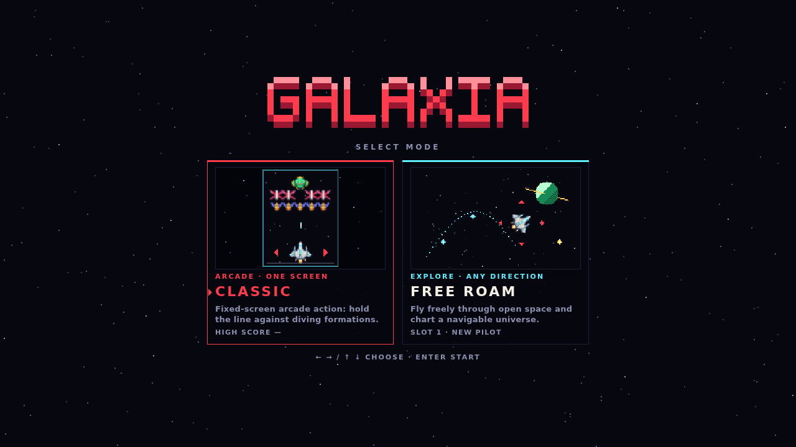
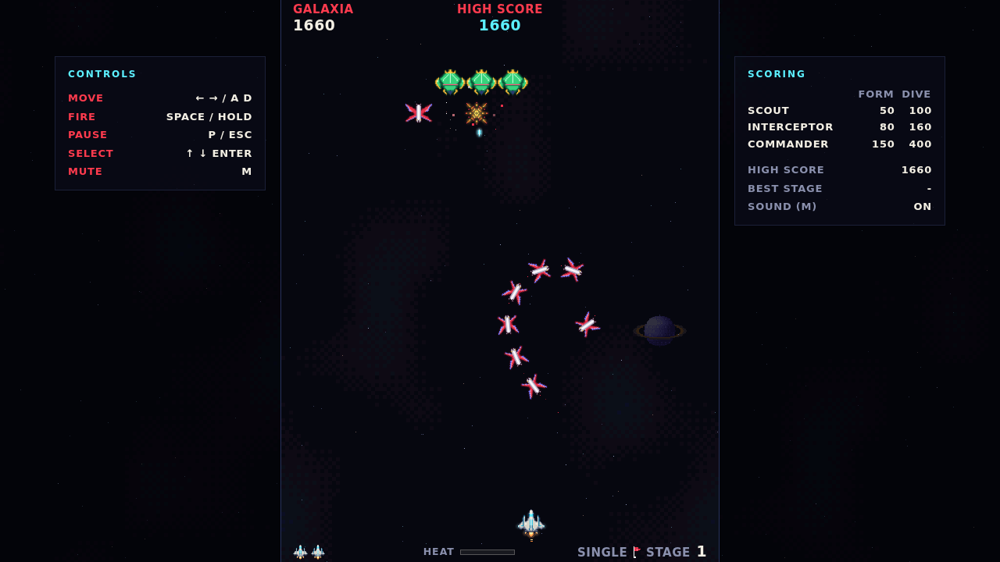
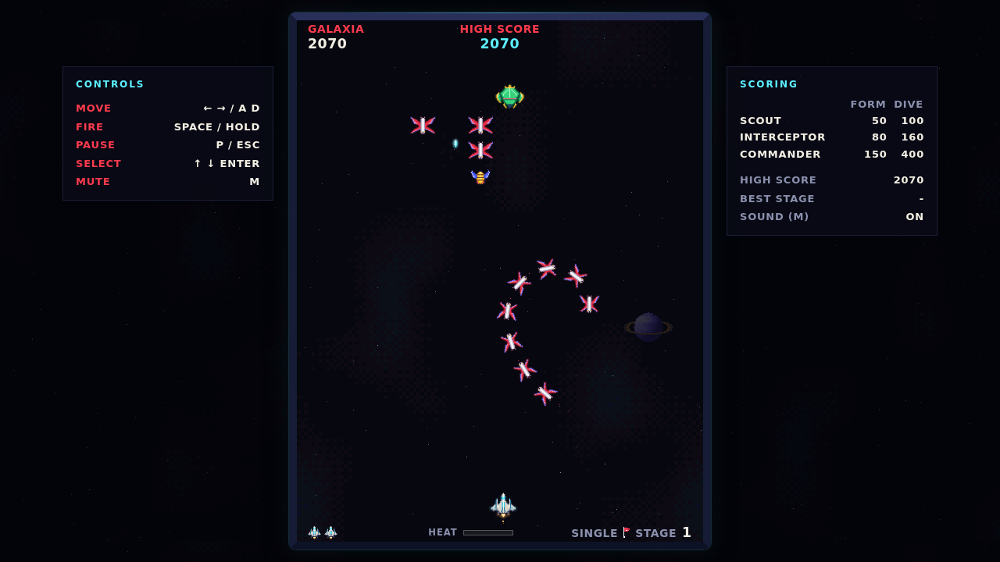
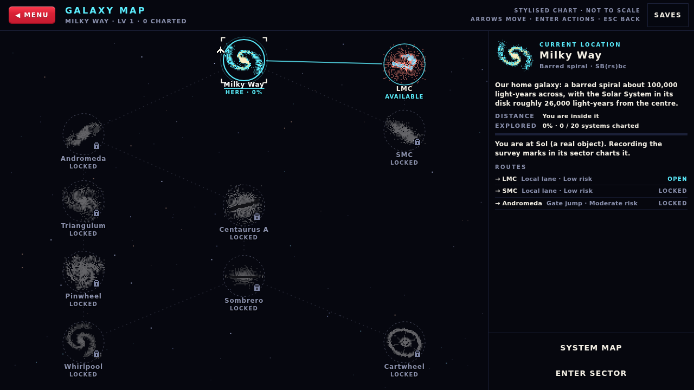
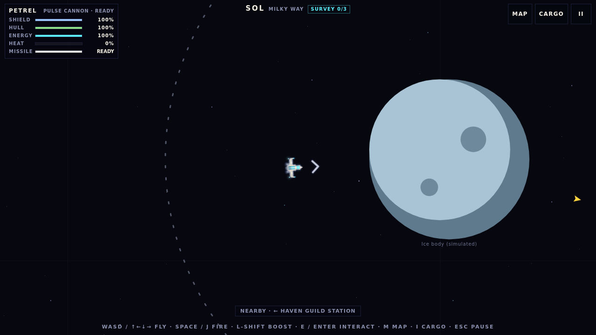
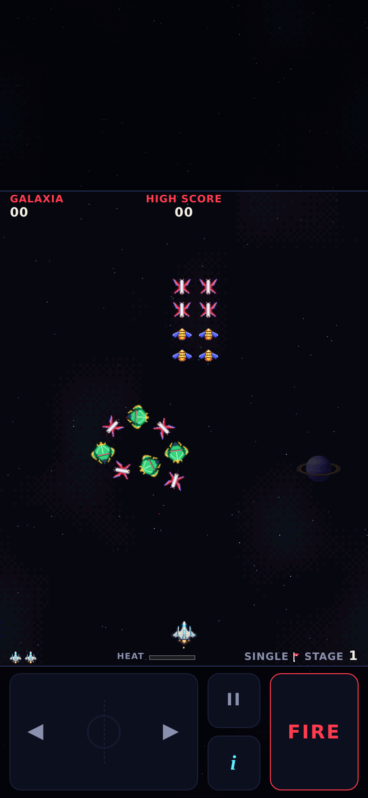

# GALAXIA

**An original browser space game with two modes: a fixed-screen arcade shooter and an open-space exploration prototype.**

Vite · TypeScript · HTML Canvas 2D · Web Audio API · Vitest · GitHub Actions and GitHub Pages

- **Status:** Classic Mode is complete and playable. Free Roam Mode is a playable prototype; its latest update (P03) adds a guided missile, slower shield recovery for light enemies, and planet and star gravity. Release builds pass all automated checks. The P03 changes have not yet been playtested by people, and the site has not been deployed (see [Project status](#project-status-and-roadmap)).
- **Licence:** [MIT](LICENSE) for GALAXIA's own code and content. The copyright holder line in `LICENSE` is still a placeholder.
- **Platform:** current desktop and mobile browsers, as a static site with no server, accounts or tracking.

---

## Contents

- [Screenshots](#screenshots)
- [Overview](#overview)
- [Features](#features)
- [Technology stack](#technology-stack)
- [Project structure](#project-structure)
- [Getting started](#getting-started)
- [Controls](#controls)
- [Architecture](#architecture)
- [Save data and browser support](#save-data-and-browser-support)
- [Testing and quality assurance](#testing-and-quality-assurance)
- [Deploying to GitHub Pages](#deploying-to-github-pages)
- [Project status and roadmap](#project-status-and-roadmap)
- [Licence and attribution](#licence-and-attribution)
- [Reporting issues and contributing](#reporting-issues-and-contributing)

---

## Screenshots

<table>
  <tr>
    <td width="50%"></td>
    <td width="50%"></td>
  </tr>
  <tr>
    <td align="center"><sub>Mode select</sub></td>
    <td align="center"><sub>Classic: Responsive Display (default)</sub></td>
  </tr>
  <tr>
    <td></td>
    <td></td>
  </tr>
  <tr>
    <td align="center"><sub>Classic: Arcade Display</sub></td>
    <td align="center"><sub>Free Roam: Galaxy Map</sub></td>
  </tr>
  <tr>
    <td></td>
    <td align="center"></td>
  </tr>
  <tr>
    <td align="center"><sub>Free Roam: planet gravity and the missile row</sub></td>
    <td align="center"><sub>Classic on a phone (touch controls)</sub></td>
  </tr>
</table>

<sub>Captured from the release build in headless Chromium: desktop at 1280×720; phone emulated at 390×844. The Free Roam sector shot (recaptured 2026-10-22 for P03) comes from the same build with read-only test hooks, used only to place the ship beside a planet.</sub>

---

## Overview

GALAXIA is a browser game built around two different ways to fly.

- **Classic Mode** is a fixed-screen arcade shooter in the tradition of early-1980s formation shooters. Alien squadrons fly in along scripted paths, lock into formation and break off to dive at you. The ship moves left and right only, and the playfield never scrolls.
- **Free Roam Mode** is an exploration prototype. You fly in any direction through procedurally generated star-system sectors, chart them, salvage, fight and dock at stations. A map links ten real galaxies (stylised, not to scale).

Both modes share one page, one settings store and one display system, but they are separate programs inside it. Free Roam's code is downloaded only when you first choose it, so Classic players never load it.

GALAXIA uses web technology so that it runs anywhere a modern browser does, from a desktop with a gamepad to a phone in portrait. It is a static site: after the page loads, the only network request is the one-time download of the Free Roam code from the same site. Sprites, fonts and sounds are all generated in code, so there are no image, font or audio files to fetch.

---

## Features

### Classic Mode

- **Formation combat:** 40-enemy formations with scripted entry flights, diving attacks with escorts, and aimed enemy fire.
- **Capture and rescue:** a commander can capture your fighter with a tractor beam. Shoot that commander while it dives to free the captive and fly a **Dual Fighter** (two ships, two shots). Destroy the commander while it sits in formation and the captive turns hostile.
- **Challenging Stages:** stage 3 and every fourth stage after it (7, 11, …). Five waves of eight enemies that do not shoot, with wave bonuses and a perfect bonus.
- **Transforms:** from stage 4, a scout can split into a three-ship group.
- **Scoring:** enemies are worth more when attacking than in formation, and a commander's value depends on its escorts. Extra fighters at 20,000 and 70,000 points, then every 70,000. There are no power-ups or random drops.
- **Endless play:** stages keep counting with no final stage. Difficulty ramps up over the early stages and then holds at its limits. The game ends when your last fighter is lost.
- **Weapon heat:** holding fire keeps shooting (two shots on screen, four with the Dual Fighter). A long hold fills the **HEAT** bar until the weapon overheats and locks briefly. Taps and short bursts never overheat it.
- **HUD:** the player score sits top left under the **GALAXIA** label, with HIGH SCORE in the centre and reserves and the stage number along the bottom.

### Free Roam Mode (prototype)

- **Navigation:** a **Galaxy Map** of 10 galaxies with routes and locked destinations, and a **System Map** for each galaxy (15–20 systems each, 170 in total) with lanes, route planning, sealed systems and information revealed by exploring. Selecting a destination never travels by itself; every jump is confirmed.
- **Local sectors:** every one of the 170 systems has a generated sector (deterministic from its seed) with stars, bodies, asteroid fields and clouds. You can record survey marks to chart the system, salvage, inspect wrecks, open caches, investigate anomalies, mine ore veins, dock at stations and use gates to neighbouring systems.
- **Flight:** movement in any direction with assisted inertia, boost, a follow camera with zoom, and optional mouse aim (off by default).
- **Combat:** four original factions (the Tessellate, the Red Tally, the Cordon and the Gleaners) field eight enemy families. You meet them in patrols, outposts, ambushes, duels with elites and fights with capital ships. Dangerous attacks are telegraphed, and hazards include minefields, sensor interference and eruption fields. Encounter rewards pay out once. If your ship is destroyed, you are recalled, and half your cargo stays in a wreck you can fly back to.
- **Missile skill:** every ship carries one guided missile alongside its guns.
  - **Lock:** pressing the missile control locks onto the hostile ahead of your nose (within 600 px and about 31° of the nose) over 0.3 s.
  - **Flight:** the missile then launches and homes on its target, dealing one 18-point hit (shields first).
  - **Cost:** it uses 30 of the ship's boost energy and then recharges for 12 seconds. There is no ammunition or extra currency.
  - **HUD:** the ship card's **MISSILE** row shows READY, LOCK, the flight and the countdown, or why it refused (NO TARGET, LOW ENERGY, LOCK LOST).
- **Enemy recovery:** the five lightest enemy families (Raider, Picket, Lancer, Recon and Hauler) wait twice as long before their shields start to recharge, so weak ships can be finished off. Heavier ships recover as before.
- **Gravity:** every planet and star pulls your ship.
  - **Strength:** strongest near the surface, fading to nothing at five radii, and always weaker than the engine, so you can fly out at full thrust.
  - **Field ring:** a dotted ring appears around a body as you approach, marking where the pull becomes noticeable.
  - **Pull arrow:** a chevron beside the ship points where you are being pulled, doubled when the pull is strong.
  - **Scope:** only your ship is pulled, not enemies, shots or pickups.
- **Ships:** six original ships (Petrel, Swift, Shrike, Condor, Magpie, Albatross), acquired with licences earned through play and switched in a station's hangar.
- **Cargo and crafting:** a limited cargo hold with sorting and details. When the hold is full, you choose what to keep; nothing is discarded silently. Stations also have a fabricator for equipment and an equipment fitting screen.
- **Missions and economy:** a ten-mission Guild story chain, per-station contract boards, an exchange where every trade previews its result, and per-ship upgrades (Mk I–III).
- **Never stranded:** jumps burn reactor cells, but docking tops up a shortfall, and free emergency jumps and a free return home are always available.
- **Exploration record:** real, cited astronomy is kept separate from in-game fiction.

### Controls and responsiveness

- Keyboard, mouse, touch and gamepad are all supported, and they can be mixed: the newest input wins.
- Touch controls appear only on touch devices: a slide pad and FIRE button in Classic, and a floating stick with action buttons in Free Roam.
- Free Roam flight keys can be rebound, and the bindings are saved.
- The game pauses and releases every held input when the tab is hidden, the window loses focus, or a phone is rotated mid-game.
- Menus are fully keyboard-operable, with visible focus. Nothing depends on hover.

### Rendering and presentation

- Pixel-art sprites and a bitmap font, defined in code as pixel grids.
- A parallax starfield behind the title screen and both modes.
- Classic's 448×576 playfield is scaled to the largest size that fits. It is never stretched or cropped, and the page never scrolls. The margins show a dimmed continuation of the star field, with a thin edge marking the playfield.
- **Display settings (Classic):** **Responsive Display** (the default) makes the playfield as large as its proportions allow; **Arcade Display** shows it as a centred, framed arcade screen. Switching applies instantly mid-game and is remembered.
- **Adaptive render resolution:** the game canvases lower their internal resolution when frames stay slow and restore it gradually. Menus and the HUD stay sharp.
- **Sound:** synthesised in the browser with the Web Audio API, with mute and volume controls and a safety limiter. Sound starts only after your first interaction with the page.
- Glow, whole-pixel scaling, Reduced Motion (following the system setting by default) and fullscreen, where the browser supports it.

### Persistence and settings

- The Classic high score, best stage and all settings are saved in the browser.
- Free Roam has **three independent save slots**. It autosaves at milestones and every minute of flight, and resumes where you were after a reload.
- Saves are versioned and validated. A corrupt or outdated save is repaired, migrated or backed up instead of crashing the game.

### Testing and deployment

- 1,603 deterministic Vitest tests (seeded, offline, no browser needed), plus a long Classic soak run.
- `npm run verify:dist` checks the production build before it is published.
- Optional browser test scripts (Playwright) for both modes.
- A GitHub Actions workflow that typechecks, tests, builds, verifies and deploys to GitHub Pages.

---

## Technology stack

| Technology | Role in GALAXIA |
|---|---|
| **TypeScript 6** (strict) | All game, tooling and test code. The compiler runs as a typecheck only; Vite does the bundling. |
| **Vite 8** | Development server and production bundler. It splits Free Roam into its own lazily loaded chunk and resolves the deployment base path. |
| **HTML Canvas 2D** | All gameplay rendering: sprites, starfields, effects and maps. Menus, the HUD and panels are ordinary HTML and CSS above the canvas. |
| **Web Audio API** | Every sound effect and jingle, synthesised at runtime from small recipes. No audio files ship. |
| **Gamepad API, Pointer Events, Fullscreen API** | Controller input, touch and mouse input, and optional fullscreen. |
| **`localStorage`** | Browser-local saves and preferences, with an in-memory fallback when storage is blocked. |
| **Vitest 5** | Unit, integration and soak tests in Node (no DOM emulation). |
| **GitHub Actions and GitHub Pages** | Continuous build, verification and static hosting ([`deploy.yml`](.github/workflows/deploy.yml)). |
| **Playwright** (optional, not a dependency) | Browser test scripts in `docs/development/playtest/`. Install it separately if you want to run them. |

The game has **no runtime dependencies**. The four development dependencies are TypeScript, Vite, Vitest and `@types/node`, pinned in `package-lock.json`. The only third-party code in the published bundle is Vite's small module-preload helper (MIT); its notice ships with the site.

---

## Project structure

```text
.
├── index.html                 Page shell and boot watchdog
├── package.json               Scripts and development dependencies (npm)
├── package-lock.json          Exact dependency versions
├── vite.config.ts             Base path, build flags, 404 page, test config
├── tsconfig.json              Strict TypeScript settings
├── .nvmrc                     Node.js version used locally and in CI
├── LICENSE                    MIT licence
├── .github/workflows/
│   └── deploy.yml             Test, build, verify and deploy to GitHub Pages
├── public/                    Copied to the site as-is: favicons, THIRD_PARTY_NOTICES.txt
├── src/
│   ├── main.ts                Entry point: mounts the mode host
│   ├── modes/                 Mode host and mode lifecycle
│   │   ├── classic/           Adapter that runs Classic inside the mode host
│   │   └── freeroam/          Free Roam (lazy chunk; never imports Classic)
│   │       ├── galaxy/        Galaxy Map and System Map
│   │       ├── sector/        Local sector generation, simulation and planet gravity
│   │       ├── catalogue/     Galaxy and star-system data with cited sources
│   │       ├── combat/        Factions, enemies, AI, weapons, missile skill, hazards, encounters
│   │       ├── gravity/       Gravity Flight test sector (dev and QA builds only)
│   │       ├── ships/         Ship roster, equipment, hangar, upgrades
│   │       ├── inventory/     Resources, loot tables, cargo hold, fabricator, milestones
│   │       ├── progression/   Missions, contracts, economy, reactor cells, discovery record
│   │       ├── audio/         Free Roam sound cues
│   │       └── ui/            Panels, HUD, overlays
│   ├── core/                  Classic simulation: pure TypeScript, no DOM
│   │   ├── game/              Fixed-step engine, phase machine, input contract
│   │   ├── systems/           Player, formation, attacks, capture, collisions, …
│   │   └── rewards/           Scoring, extra fighters, statistics
│   ├── game/                  Classic shell: frame loop, presentation, menus
│   ├── render/                Classic Canvas 2D renderer, viewport fitting, effects
│   ├── ui/                    Classic HUD, menus, side panels, layout
│   ├── input/                 Keyboard, touch pad and gamepad adapters
│   ├── audio/                 Web Audio synthesiser and cue scheduling
│   ├── persistence/           Classic save data and safe storage
│   ├── shared/                Services both modes use: lifecycle, prefs, records,
│   │                          audio, input helpers, canvas surface, title screen
│   ├── config/                Tunable data: scoring, difficulty, stages, palette,
│   │                          audio recipes, display, build flags
│   ├── assets/                Pixel-grid sprite and bitmap-font definitions
│   └── showcase/              Developer sprite viewer (dev and QA builds only)
├── tests/                     Vitest suites, fixtures and helpers
├── scripts/                   Build-output verifier, soak runner, icon and doc generators
└── docs/
    ├── media/                 README screenshots
    ├── freeroam/              Asset licence register and astronomy sources
    └── development/playtest/  Optional Playwright browser test scripts
```

The source repository also contains internal design records, QA reports and tooling configuration (for example `docs/design/`, the technical-decision logs and `.claude/`). They document how the game was built, are not part of its runtime, and are left out of the release archive.

---

## Getting started

### Prerequisites

- **Node.js 24** (the version in [`.nvmrc`](.nvmrc)). The minimum supported version is **22.18**, which can run the TypeScript build scripts directly.
- **npm**, bundled with Node.js. The project uses npm and its `package-lock.json`; please do not add another package manager's lockfile.

No accounts, API keys or environment secrets are needed.

### Install and run

```sh
npm ci          # install exactly the versions in package-lock.json
npm run dev     # development server at http://localhost:5173/
```

The development server listens on all interfaces, so you can open it from a phone on the same network. It includes developer-only URL options (see [Development builds](#development-builds)).

### Build and preview

```sh
npm run build      # typecheck, then build into dist/
npm run preview    # serve dist/ at http://localhost:4173/
```

Without `BASE_PATH`, the build uses relative URLs and works from any folder. To build for a specific hosting path, such as a GitHub project page at `/galaxia/`, set `BASE_PATH` for both the build and the preview:

```sh
BASE_PATH=/galaxia/ npm run build
BASE_PATH=/galaxia/ npm run verify:dist   # check dist/ before publishing
BASE_PATH=/galaxia/ npm run preview       # http://localhost:4173/galaxia/
```

On Windows PowerShell, set the variable first: `$env:BASE_PATH="/galaxia/"; npm run build`.

### Scripts

| Command | What it does |
|---|---|
| `npm run dev` | Development server with developer tools |
| `npm run build` | Typecheck and production build into `dist/` |
| `npm run preview` | Serve `dist/` locally |
| `npm run typecheck` | `tsc --noEmit` (strict) |
| `npm test` | All Vitest tests |
| `npm run test:soak` | Long Classic soak run (seeded autopilot games with invariant checks) |
| `npm run check` | Typecheck, tests, production build and `verify:dist` in one step |
| `npm run verify:dist` | Check the built `dist/` (see [Testing](#testing-and-quality-assurance)) |
| `npm run build:e2e` | Release build plus read-only test hooks, into `dist-e2e/`, for the browser test scripts |
| `npm run preview:e2e` | Serve `dist-e2e/` |
| `npm run build:qa` | Production build with developer tools, for device testing only (never deploy it) |
| `npm run icons` | Regenerate the favicons in `public/` from the player sprite |
| `npm run sprites:sheet` | Export sprite contact sheets to `docs/design/review/` for art review |
| `npm run catalogue:doc` | Regenerate the source tables in `docs/freeroam/ASTRONOMY_SOURCES.md` |

### URL options

| Option | Builds | Effect |
|---|---|---|
| `?mode=classic` / `?mode=freeroam` | All | Open that mode directly |
| `?seed=<n>` | All | Reproducible Classic enemy behaviour |
| `?controls=touch` / `?controls=keyboard` | All | Force the touch or the desktop layout |

#### Development builds

`npm run dev` and `npm run build:qa` also accept these options. Release builds compile the tools out entirely and ignore the parameters.

- `?stage=<n>`: start at stage *n*.
- `?debug=1`: hitbox overlay.
- `?view=hangar`: sprite viewer.
- `?mode=freeroam&lab=gravity`: the experimental Gravity Flight test sector, with its tuning panel and diagnostics.

---

## Controls

### Classic Mode

| Action | Keyboard | Touch | Gamepad |
|---|---|---|---|
| Move left / right | ← → or A D | Slide a thumb on the ◀ ▶ pad (centre dead zone; lifting stops the ship) | Left stick or D-pad |
| Fire | Space (also Z or X): tap for one shot, hold to keep firing | Tap or hold **FIRE** | A (also X) |
| Pause / resume | P or Esc | **II** | Start (B also resumes) |
| Controls and scoring help | — | **i** (pauses the game) | — |
| Menus | ↑ ↓ to choose, Enter to confirm | Tap a button | D-pad, A to confirm, B to go back |
| Mute / unmute | M | Settings | — |
| Back to mode select | Esc on the Classic title, or **◀ MENU** | **◀ MENU** | B on the Classic title |

The mouse can click every menu button. Only two of your shots can be on screen at once (four with the Dual Fighter). On a touch screen, use two thumbs to move and fire together. FIRE never resumes a paused game.

### Free Roam: flight

| Action | Keyboard and mouse (defaults, rebindable) | Touch | Gamepad |
|---|---|---|---|
| Fly in any direction | W A S D or arrow keys | Floating stick: drag from anywhere on the open screen | Left stick or D-pad |
| Aim (optional) | Mouse, when CONTROLS → MOUSE AIM is on | — (shots go where the ship points) | Right stick |
| Fire (hold; heats the weapon) | Space or J (left mouse button with mouse aim) | **FIRE** | RT, RB or X |
| Boost (hold; uses energy) | Shift | **BOOST** | LB or LT |
| Missile (lock on the hostile ahead, then launch) | Q or K | **MSL** | Right-stick click (R3) |
| Interact with the nearest object (inspect, open, dock, use gate, leave) | E or Enter | **INTERACT** (appears in range) | A |
| Sector map (pauses) | M | **MAP** | Select / View |
| Cargo hold (pauses) | I | **CARGO** | Y |
| Zoom | = and − or the mouse wheel | CONTROLS → ZOOM | — |
| Pause | Esc or P | **II** | Start |

Keys are rebound under pause → CONTROLS. Escape always pauses and cannot be rebound, and no action can lose its last key. The on-screen MAP, CARGO and pause buttons also work with the mouse.

### Free Roam: maps, panels and stations

| Action | Keyboard | Mouse or touch | Gamepad |
|---|---|---|---|
| Move between galaxies, systems or menu items | Arrow keys or W A S D | Click or tap | D-pad |
| Confirm (travel, enter sector, ENGAGE) | Enter or Space | Click or tap the button | A |
| Back or cancel | Esc | CANCEL, ◀ MENU or ◀ GALAXIES | B |
| Switch station tabs | `[` and `]`, or Page Up and Page Down | Tap a tab | X |
| Restart the flight (from the pause menu) | R | RESTART FLIGHT | — |

---

## Architecture

### Modes and lifecycle

`src/main.ts` mounts a **mode host** that shows the title screen and runs one mode at a time. Each mode implements the same lifecycle (`init`, `activate`, `pause`, `resume`, `dispose`) and owns its own state, loop, rendering, input, pause handling and saves. Leaving a mode disposes of everything it created (listeners, timers, audio nodes, canvases), so switching modes repeatedly does not leak. Free Roam is loaded through a dynamic `import()` and becomes a separate chunk in the build. An architecture test makes sure Classic never imports Free Roam.

### Simulation and rendering

- **Classic:** the simulation in `src/core/` is pure TypeScript with no DOM access. It advances in fixed 60 Hz steps and is deterministic for a given seed. Enemy behaviour comes from scripted, original flight paths and a seeded random number generator. The renderer in `src/render/` only reads simulation state, so presentation can never change an outcome. Layer boundaries (for example, "core never imports the DOM, renderer or UI") are enforced by `tests/architecture.test.ts`.
- **Free Roam:** each sector is generated deterministically from the system's seed. Only progress is saved; layouts are regenerated on demand, and only the sectors you visit are generated.
- **Tunable data** (scoring tables, difficulty ramps, stage schedules, palettes, audio recipes, display budgets) lives in `src/config/`, separate from the logic that uses it.

### Input

Input is gathered by small adapters (keyboard, Pointer Events touch controls, polled Gamepad API) and turned into abstract actions before the game sees it. Classic's simulation receives an input contract per frame, never raw events. Free Roam reads its rebindable key map, the touch stick and the gamepad into a single flight-control state. Focus loss, hidden tabs and orientation changes release every held input and pause.

### Responsive sizing and resolution

Both modes share one viewport system for the full-screen canvas: CSS size, device pixel ratio, safe-area insets, and resize and rotation handling. Logical gameplay coordinates never depend on the screen. Classic fits its fixed 448×576 arena; Free Roam's camera shows more or less of space. The canvas backing store is reallocated only when its size actually changes, never every frame. An adaptive render-scale controller samples frame times (excluding paused time), lowers resolution in steps after sustained slow frames, and restores it gradually with hysteresis. It is limited to the game canvases.

### Persistence

All saves go through one versioned record loader that sanitises, repairs, migrates and backs up data. The Classic save, shared preferences and each Free Roam slot are separate records, so one can never corrupt another. Saving is event-driven (milestones, pausing, hiding the tab, a one-minute flight timer), never every frame.

### Build configuration

`vite.config.ts` turns three compile-time flags into literals:

- **Developer tools:** development and QA builds only.
- **Gravity Flight test sector:** development and QA builds only.
- **Read-only test hooks:** development, test and `build:e2e` builds only.

A release build contains none of them, and `verify:dist` rejects a build that does. The same file resolves the deployment base path from `BASE_PATH` and writes a `404.html` that sends unknown URLs back to the game.

---

## Save data and browser support

### Where progress is stored

Everything is stored as versioned JSON in the browser's `localStorage`, on the current device only:

| Key | Contents |
|---|---|
| `galaxia:save` | Classic high score and best stage |
| `galaxia:prefs` | Shared settings: sound and volumes, glow, pixel scaling, motion, Arcade Display |
| `galaxia:freeroam:prefs` | Free Roam controls: key bindings, mouse aim, zoom |
| `galaxia:freeroam`, `galaxia:freeroam:slot2`, `galaxia:freeroam:slot3` | The three Free Roam save slots |
| `galaxia:freeroam:slots` | Which Free Roam slot is in use |

Before a damaged record is repaired or an old one is migrated, a backup copy is written next to it. A save written by a newer version of the game is read but never overwritten.

### Limitations

- **Saves are local.** They stay in one browser on one device. There are no accounts, no cloud sync, no save export and no online leaderboard.
- Clearing site data or using a private window removes them.
- **When storage is blocked,** the game still plays, keeps progress only until the tab closes, and says so on screen. If a write fails (for example, storage is full), Free Roam keeps running, shows a warning and retries at the next save.
- Playing the same Free Roam slot in two tabs at once: the last save wins.
- All GitHub Pages projects under one `https://<user>.github.io` address share the same storage origin and quota. The game validates its data on load.
- There is no offline mode: no service worker or web app manifest.

### Browser and hosting assumptions

- GALAXIA targets current versions of Chromium-based browsers, Firefox and Safari (WebKit), on desktop and mobile. Automated tests ran in headless Chromium, Firefox and WebKit; see [Testing](#testing-and-quality-assurance) for what that does and does not cover.
- It needs JavaScript, Canvas 2D and ES2022 support. Sound needs the Web Audio API and starts only after the first tap, click or key press, as browsers require.
- It is a single page with no client-side routes, so any static host works. It can be served from the root of a domain or from a sub-path.

---

## Testing and quality assurance

### Automated checks

```sh
npm run check       # typecheck + all tests + production build + verify:dist
npm test            # Vitest only
npm run test:soak   # long Classic soak run
```

- **Unit and integration tests:** 61 test files and 1,603 tests as of 2026-10-22, all deterministic (seeded) and offline.
  - 1,586 run on every check.
  - The other 17 are opt-in measurement runs (simulated pilots for combat and gravity tuning). They are reported as skipped unless enabled with an environment variable, for example `COMBAT_MEASURE=1` or `GRAVITY_SECTOR_MEASURE=1`.

  The tests cover:
  - the Classic engine: formations, attacks, capture, scoring, stage progression to stage 300, and play sequences driven by real input frames;
  - Free Roam: generation of all 170 sectors, navigation, combat (including the missile skill and enemy shield recovery), planet and star gravity, loot, missions, economy, saves and migrations, and full journeys flown with flight input;
  - layout and viewport maths, adaptive render scale, pause and resume, menu focus, audio and gamepad lifecycles;
  - architecture boundaries and release rules (workflow structure, build flags, asset register).
- **Soak test:** `npm run test:soak` plays 57 seeded autopilot Classic games (about 149 simulated minutes) and checks game invariants on every tick.
- **Build verification:** `npm run verify:dist` ([`scripts/verify-dist.ts`](scripts/verify-dist.ts)) fails the build if any of these hold:
  - a URL in `index.html` or `404.html` is missing the base path or names a missing file;
  - JS or CSS references an asset that does not exist;
  - developer tools, the Gravity Flight test sector, test hooks or source maps are present;
  - Free Roam has been bundled into the first download;
  - a gzip size budget is exceeded.

In the release archive, two more tests are reported as **skipped**: they compare the asset register with internal audit documents, which stay in the source repository. The archive therefore shows 1,584 passed and 19 skipped (the 17 opt-in measurement runs plus these two). Every other test runs.

### Browser test scripts (optional)

`docs/development/playtest/` contains Playwright scripts that run the built game in real browser engines. Playwright is **not** a project dependency. Install it in a separate folder, for example `npm i playwright && npx playwright install chromium firefox webkit`, then run:

| Script | Checks | Run against |
|---|---|---|
| [`release-smoke.mjs`](docs/development/playtest/release-smoke.mjs) | The real release build: no test hooks, both modes play, pause and resume, the HUD label at five screen sizes in both displays, settings across a reload | `npm run preview` |
| [`release-p16.mjs`](docs/development/playtest/release-p16.mjs) | Both modes behind a built-in GitHub Pages-like server: lazy loading, saves across a reload, deep links, the 404 page, four screen sizes | A `build:e2e` output folder |
| [`pause-resume.mjs`](docs/development/playtest/pause-resume.mjs) | Pause and resume by button and key, mid-attack, with tab switches, and a single game loop | `npm run preview:e2e` |
| [`controller-sim.mjs`](docs/development/playtest/controller-sim.mjs) | A simulated gamepad: connect, play, pause, disconnect and reconnect, keyboard coexistence | `npm run preview:e2e` |
| [`arcade-display.mjs`](docs/development/playtest/arcade-display.mjs) | Responsive and Arcade Display across screen sizes, switching mid-game, keyboard focus in settings | `npm run preview:e2e` |

Example:

```sh
BASE_PATH=/galaxia/ npm run build && BASE_PATH=/galaxia/ npm run preview
node docs/development/playtest/release-smoke.mjs http://localhost:4173/galaxia/ chromium,firefox,webkit
```

### What has and has not been verified

- **Verified automatically (2026-10-21):** the checks above in headless Chromium, Firefox and WebKit, including emulated phones and tablets, simulated gamepads, and Free Roam focus and pause behaviour repeated in Firefox.
- **P03 (2026-10-22, headless Chromium only):**
  - the missile on keyboard and touch, including the MSL button's placement at several screen sizes;
  - the gravity ring, the pull arrow, drift and escape near a planet;
  - the Gravity Flight test sector in a QA build.

  These ran with harnesses kept outside the repository. The release smoke test above was re-run on the P03 release build.
- **Not playtested:** no person has played the P03 changes since the first feedback was applied.
- **Not verified:** physical phones and tablets, iOS Safari on a real device, real game controllers, real GPUs and high-refresh displays, and how the audio sounds to a listener.
- **Performance** was measured only in headless, software-rendered Chromium on a two-core machine. Those numbers do not predict any particular device, and no frame rate is guaranteed.

---

## Deploying to GitHub Pages

The repository includes [`.github/workflows/deploy.yml`](.github/workflows/deploy.yml), which builds, verifies and publishes the site with GitHub's official Pages actions. **It has not yet been run on GitHub**, so treat the first deployment as part of the release and check the live site afterwards.

### One-time setup

1. Create a GitHub repository (any name), add it as the remote and push the `main` branch:
   ```sh
   git remote add origin https://github.com/<user>/<repo>.git
   git push -u origin main
   ```
2. In the repository, open **Settings → Pages → Build and deployment → Source** and select **GitHub Actions**.
3. The push starts the workflow. You can also run it manually from **Actions → Deploy to GitHub Pages → Run workflow**.

After a successful run, the site is served at `https://<user>.github.io/<repo>/`, or at your custom domain if one is configured.

### What the workflow does

- **Triggers:** every push to `main`, plus manual runs. One deployment runs at a time, and a deployment in progress is never cancelled.
- **Build job** (read-only permissions):
  1. checks out the code without keeping credentials;
  2. sets up Node.js from `.nvmrc`;
  3. runs `npm ci`, the typecheck and all tests;
  4. builds with the base path reported by `actions/configure-pages`;
  5. runs `npm run verify:dist`;
  6. uploads `dist/`.
- **Deploy job** (`pages: write`, `id-token: write`, environment `github-pages`): publishes the artifact.
- A failing step stops the run before anything is published. No secrets are used; Pages authenticates with a short-lived OIDC token. Every action is pinned to a full commit SHA.

### Base path

Asset URLs depend on where the site is hosted, so `vite.config.ts` reads the base path from the `BASE_PATH` environment variable:

| Situation | Base | How it is set |
|---|---|---|
| Local development (`npm run dev`) | `/` | Always |
| Project page, `https://<user>.github.io/<repo>/` | `/<repo>/` | Automatically in CI; locally with `BASE_PATH=/<repo>/` |
| User or organisation page, or custom domain | `/` | Automatically in CI; locally with `BASE_PATH=/` |
| Any folder or unknown location | `./` | Leave `BASE_PATH` unset |

You do not need to write the repository name anywhere. The workflow asks GitHub for the real base path, so renaming the repository or adding a custom domain keeps working.

### Checking a deployment

- **Actions** tab: both the *Test and build* and *Deploy* jobs should be green. The Deploy job shows the published URL.
- **Settings → Pages** shows the current site address and the latest deployment.
- On the live site, check that the title screen shows both modes and that the browser's network panel shows no failed requests. `<site>/THIRD_PARTY_NOTICES.txt` should load.

### Troubleshooting

| Symptom | Likely cause and fix |
|---|---|
| The workflow fails at *Verify build output* | Read the `FAIL` lines: each names the file and the rule broken. Fix the cause; do not bypass the check. |
| The deploy job fails, or no site appears | Check that **Settings → Pages → Source** is set to **GitHub Actions**, then re-run the workflow. Organisation policies may also restrict which actions can run. |
| Blank page, or 404 errors for `assets/…` locally | The preview's `BASE_PATH` differs from the build's. Use the same value for both, and open the matching URL (for example `http://localhost:4173/galaxia/`). |
| A mistyped URL on the site | `404.html` sends visitors back to the game's start page. |
| "Free Roam could not load" right after a deploy | That tab still has the previous version's page. Reload it; Classic keeps working in the meantime. |
| The page never finishes loading | A watchdog shows **COULD NOT LOAD** with a reload button after 15 seconds. This usually means a cached old page; reloading fixes it. |

---

## Project status and roadmap

### Implemented

- **Classic Mode:** complete. Formations, capture and rescue, Challenging Stages, transforms, scoring and extra fighters, endless stages, weapon heat, both display modes, and all input methods.
- **Free Roam Mode:** a playable prototype covering navigation across 10 galaxies and 170 systems, generated sectors, flight, combat, salvage, cargo, fabrication, ships, missions, the exchange, upgrades and three save slots. Automated tests show the ten-mission story chain can be completed through to Andromeda. The remaining galaxies unlock through exploration milestones.
- **Release engineering:** a verified production build, release-only build flags, and a validated (but not yet run) Pages workflow.

### Prototype areas and known limitations

- The P03 tuning (missile, light-enemy shield recovery) and the gravity strengths are based on simulated pilots and automated browser checks. Only the first piece of player feedback (a shorter missile lock, a stronger pull in ordinary sectors) has been applied, and the changes have not been playtested since. Touch play has no aim assist.
- Route risk, lane hazards and transit events are shown on the maps but have no gameplay effect yet. Jump costs (reactor cells) do apply.
- Prices are fixed; there is no market or trading between stations.
- There is no background music, only sound effects and short jingles. English only.
- Some original arcade rules that could not be confirmed are kept configurable: the first stage with entry fire, collisions in Challenging Stages, and the wave bonus after the eighth challenge. The score caps at 9,999,990.
- There is a single high score, with no name entry or top-ten table.
- The in-flight control hint bar does not list the missile key yet. It is shown in the controls table above and under pause → CONTROLS.

### Next steps, in priority order

1. **Before publishing:** replace the copyright holder placeholder in `LICENSE`, and settle the owner's open decisions on the name and the Classic presentation (see [Licence and attribution](#licence-and-attribution)).
2. **First deployment:** push to GitHub, run the workflow and check the live site.
3. **Real-device testing:** physical phones and tablets (including iOS Safari), real game controllers, and a listening check of the audio.
4. **Playtest P03:** check the missile rhythm, light-enemy recovery and gravity strength with players on desktop and phone, and tune from what they report.
5. **Free Roam depth:** make route risk and lane hazards take effect, and consider save export and import.

---

## Licence and attribution

- **GALAXIA's own code and content** are released under the [MIT licence](LICENSE). You may use, copy, modify and distribute them, provided the copyright and permission notice is kept. The software comes with no warranty.
- **Copyright holder:** the `LICENSE` file currently contains a clearly marked placeholder. The owner must replace it with their legal name before publishing.
- **Original assets:** all sprites, the bitmap font and the icons are defined in code. All sounds are synthesised at runtime. The project contains no sprites, logos, sounds, music, ROM data or source code from any commercial game, and loads no external fonts, images or scripts.
- **Third-party code:** the only third-party code in the published site is Vite's module-preload helper (MIT). Its notice is in [`public/THIRD_PARTY_NOTICES.txt`](public/THIRD_PARTY_NOTICES.txt), which is published alongside the game. Build and test tools (TypeScript, Vite, Vitest and their dependencies) are not shipped.
- **Astronomy references:** Free Roam's real-world facts are written in GALAXIA's own words from cited sources (NASA, ESA, ESA/Webb, ESA/Hubble, ESO, NOIRLab and others), listed in [`docs/freeroam/ASTRONOMY_SOURCES.md`](docs/freeroam/ASTRONOMY_SOURCES.md). No agency images or logos are used, and no agency endorses GALAXIA.
- **Asset register:** every asset, package and reference, with its origin, licence and status, is listed in [`docs/freeroam/CONTENT_AND_ASSET_LICENSES.md`](docs/freeroam/CONTENT_AND_ASSET_LICENSES.md).
- **Inspiration and open questions:** Classic Mode is an independent, fan-made homage inspired by early-1980s arcade formation shooters, especially *Galaga*. It is not affiliated with, endorsed by or licensed by Bandai Namco Entertainment or any other rights holder, and *Galaga* is a trademark of its owner. The code and art are original, but the Classic presentation deliberately follows that style closely, and the name GALAXIA is similar to an existing arcade trademark. Both points are open owner decisions. **The project has not received legal clearance**, and the MIT licence does not change that.

---

## Reporting issues and contributing

The project does not yet have a public issue tracker or contribution policy. Once the repository is published on GitHub, use its **Issues** tab.

**When reporting a bug, include:**

- the mode (Classic or Free Roam) and, for Classic, the display setting (Responsive or Arcade);
- your browser and version, operating system and device, and whether you used keyboard, mouse, touch or a gamepad;
- the steps to reproduce, what you expected and what happened;
- any errors from the browser console. A screenshot helps for layout problems.

Never post the contents of your saves if they might contain anything you consider private. They hold only game progress, but they are yours.

**When proposing a change:**

1. Keep changes focused, and follow the existing structure: tunable values in `src/config/`, simulation logic free of DOM access, and each mode independent of the other.
2. Add or update tests for behaviour you change.
3. Run `npm run check` and make sure it passes before submitting.
4. Do not add third-party assets without recording their origin and licence in [`docs/freeroam/CONTENT_AND_ASSET_LICENSES.md`](docs/freeroam/CONTENT_AND_ASSET_LICENSES.md).
